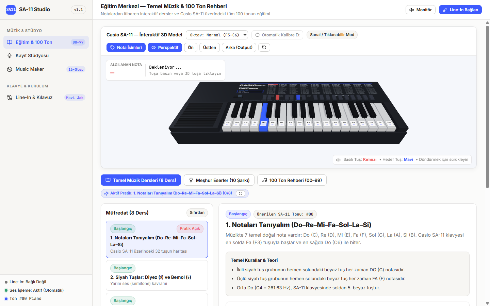
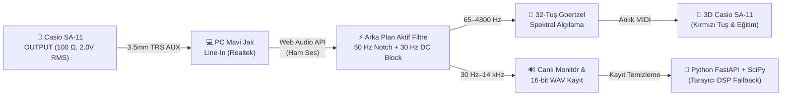

<div align="center">

# 🎹 SA-11 Studio

### Casio SA-11 İçin İnteraktif 3D Müzik, Eğitim, Kayıt & Aktif Filtre DSP Platformu

[](https://safaksahinn.github.io/casio-sa11-studio/)
[](https://www.typescriptlang.org/)
[](https://threejs.org/)
[](https://scipy.org/)

<br />

<a href="https://safaksahinn.github.io/casio-sa11-studio/">
  
</a>

<br />

**[🚀 Canlı Uygulamayı Aç (safaksahinn.github.io/casio-sa11-studio)](https://safaksahinn.github.io/casio-sa11-studio/)** · **[📘 Resmi Casio SA-11 Kullanım Kılavuzu (PDF)](docs/Casio_SA-11_Manual.pdf)** · **[🔌 Line-In Bağlantı Rehberi](docs/HARDWARE_SETUP.md)**

</div>

---

## ✨ Öne Çıkan Özellikler

| Modül | Açıklama |
| :--- | :--- |
| **🎹 İnteraktif 3D Casio SA-11** | Gerçek ölçülerine (`470 × 165 × 50 mm`) uygun 32 mini tuşlu (`F3–C6`) Three.js modeli. Gerçek klavyeden bastığınız tuş anında **kırmızı** yanar; üst paneldeki `TONE 0–9` tuşları tıklanabilir ve `Do–Re–Mi` etiketleri açılıp kapatılabilir. |
| **🔌 Gerçek Zamanlı Line-In Okuma** | PC anakartı **Mavi Line-In** girişinden ham ses yakalama, 32-tuş **Sağ-Ağırlıklı Goertzel Spektral Tarama** ile hızlı çalımda bile kararlı nota tespiti, tek tıkla **Otomatik Kalibrasyon** ve canlı **Monitör** ses sürgüsü. |
| **🎓 Eğitim Merkezi & 100 Ton** | Sıfırdan **8 temel müzik dersi**, **10 meşhur piyano eseri** (*Für Elise, Türk Marşı, Neşeye Övgü, Bach Minuet, Chopin Nocturne, Canon in D, Kuğu Gölü, Gymnopédie No. 1, Greensleeves, Eine Kleine Nachtmusik*) ve Casio SA-11'in **tüm 100 tonu (`00–99`)** için etkileşimli pratikler + `localStorage` kalıcı ilerleme. |
| **🎙️ Kayıt Stüdyosu & Aktif Filtre DSP** | Line-In WAV kaydı, arka planda **50/100/150 Hz şebeke uğultusu notch**, DC ofset kesici, doğrusal fazlı **Bessel LPF** (8-bit PCM tıslama giderme), sıfır-fazlı (`sosfiltfilt`) temizleme, Önce/Sonra FFT spektrum grafiği ve `.wav` dışa aktarma. |
| **🎛️ Music Maker (16-Step Stüdyo)** | 16 adımlı davul/ritim sekanseri (SA-11 Rock / Disco / Bossa Nova), gerçek Casio SA-11'den canlı melodi yazımı, temizlenmiş kayıt klipleri ve tek tıkla **`.wav` beste indirme**. |

---

## 🏗️ Sistem Mimarisi



---

## 🔌 Donanım Bağlantısı (Hızlı Özet)

Casio SA-11 resmi kılavuzuna ([docs/Casio_SA-11_Manual.pdf](docs/Casio_SA-11_Manual.pdf), s. 4) göre `OUTPUT` çıkışı **`100 Ω` / `2.0 V RMS MAX`** hat seviyesindedir:

- **Doğru Port:** Anakart üzerindeki **MAVİ (Line-In)** jakına standart `3.5 mm TRS–TRS` AUX kablosu ile bağlayın.
- **Windows Ayarı:** `mmsys.cpl` → *Kayıt* → `Line In` → Düzeyler `%70` civarı, *Ses Geliştirmeleri (Audio Enhancements)* kapalı.
- Ayrıntılı rehber: [docs/HARDWARE_SETUP.md](docs/HARDWARE_SETUP.md)

---

## 🚀 Kurulum & Çalıştırma

### 1. Doğrudan Tarayıcıdan (Kurulum Gerektirmez)
👉 **https://safaksahinn.github.io/casio-sa11-studio/**
*(GitHub Pages üzerinde dahili Tarayıcı DSP motoru ile sunucu gerekmeden tüm özellikler anında çalışır.)*

### 2. Yerelde Python SciPy Backend ile Çalıştırma
```powershell
# Tek komutla Python FastAPI (:8000) + TypeScript Vite (:5173) başlatır
.\start.ps1
```
- **Web Arayüzü:** `http://localhost:5173`
- **Python DSP API (Swagger):** `http://127.0.0.1:8000/docs`

---

## 📁 Proje Yapısı

```text
├── frontend/                  # TypeScript + React + Three.js Web Uygulaması
│   ├── public/                # Casio_SA-11_Manual.pdf (canlı siteden erişilebilir)
│   └── src/
│       ├── audio/             # Line-In motoru, Goertzel algılayıcı, synth & DSP istemcisi
│       ├── components/        # 3D Casio SA-11, Eğitim, Kayıt, Music Maker, Donanım Rehberi
│       ├── data/              # 32 tuş haritası, 100 ton kataloğu, 8 ders & 10 meşhur eser
│       └── styles/            # Aydınlık minimalist tema (FilterDesign Studio stili)
├── backend/                   # Python + FastAPI + SciPy Aktif Filtre & Sıfır-Fazlı WAV DSP
├── docs/                      # Resmi Casio SA-11 Kılavuzu (PDF), Donanım Rehberi & Önizleme
└── .github/workflows/         # Otomatik GitHub Pages Deploy (GitHub Actions)
```
